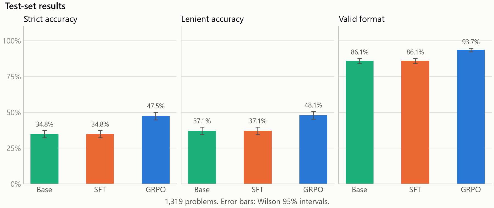
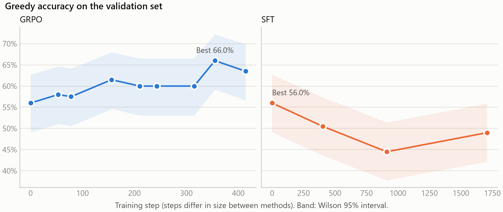

# grpo_training

GRPO on `Qwen/Qwen2.5-0.5B-Instruct` for GSM8K maths, compared with the base model and a supervised fine-tune (SFT).

## Results

Test set: 1,319 problems. Strict accuracy with 95% Wilson interval.

- Base: 34.8% (32.3–37.4)
- SFT as selected: 34.8% (32.3–37.4), identical to base because selection kept step 0
- GRPO, step 355: 47.5% (44.8–50.2)
- SFT `checkpoint-1500`, scored post-hoc: 35.6% (33.1–38.3)

Paired exact McNemar tests:

- Base vs GRPO: p = 5.5e-19 (97 only base right, 264 only GRPO right)
- SFT `checkpoint-1500` vs GRPO: p = 2.8e-16 (107 vs 263)
- SFT `checkpoint-1500` vs base: p = 0.60 (184 vs 173)

Other test metrics:

- Lenient accuracy: base 37.1%, GRPO 48.1%, SFT `checkpoint-1500` 36.1%
- Valid format: base 86.1%, GRPO 93.7%, SFT `checkpoint-1500` 96.9%
- Mean tokens: base 113.9, GRPO 142.8, SFT `checkpoint-1500` 101.4
- Clipped at limit: base 3.6%, GRPO 5.1%, SFT `checkpoint-1500` 2.9%
- On 209 of the 264 GRPO-only wins, base had a valid format and a wrong answer





- More charts: [rewards](results/default/plots/rewards.png), [length](results/default/plots/length.png)
- Raw numbers: [results/default/](results/default/)

## Method

- Adapters: LoRA, r 16, alpha 32, on `q_proj`, `k_proj`, `v_proj`, `o_proj`
- Base: no training
- SFT: learns GSM8K's human solutions, rewritten into the reply format
- GRPO: 8 sampled replies for each of 4 problems per step, each reply scored against its group
- Reply format: `<think>...</think><answer>...</answer>`
- Prompt: system instruction, one worked example as a chat turn, pre-filled `<think>`
- Reward, correct: weight 1.0, exact match of the number in `<answer>`
- Reward, format: weight 0.1, one think block, one answer block, numeric answer
- Reward, length: weight 0.05, 0 up to 700 characters, falling to -1 at 1,100
- Data: 7,273 train, 200 validation (both from GSM8K train), 1,319 test
- Checkpoint selection: validation every 30 minutes of training time, best score kept
- Scoring: greedy decoding, same prompt for all models, 256-token limit
- Test set: used for final scoring, not for choosing checkpoints

## Setup

- GPU: NVIDIA GeForce RTX 3060 Laptop, 6 GB
- Python 3.12.10, torch 2.14.1+cu126, trl 1.17.1, transformers 5.22.1, peft 0.21.2, datasets 5.1.0, accelerate 1.15.0
- Seed: 42
- Budget: 240 minutes of training per model
- GRPO: learning rate 2e-5, temperature 1.0, `beta` 0.001, `scale_rewards: batch`
- SFT: learning rate 1e-4, batch 8, stops after 3 validations without improvement
- All settings: [configs/default.yaml](configs/default.yaml)
- Versions, config and commit for each stage: `results/default/env_*.json`

## Run sizes

- GRPO: 240.4 minutes, 414 steps, 13,248 sampled replies
- SFT: 90.1 minutes, 1,708 steps, 13,664 examples, stopped early
- Whole run: 6 h 41 min ([stage_times.txt](results/default/stage_times.txt))

## What went wrong

- Base model ignored the format: instructions and examples alone gave 0.0% valid format, so the prompt was changed ([prompt_selection.json](results/default/prompt_selection.json))
- Reward hacking in an early smoke run: replies collapsed when the length penalty was the only signal. Fixed with a usable prompt and `scale_rewards: batch`. Logs not kept, so no figures
- Stale `datasets` cache served old prompts while runs exited cleanly. Caching is now off, with a test
- TRL closed the pre-filled reply in conversational prompts. GRPO now gets rendered strings, with a guard
- Chunks of 8 replies needed more memory than the 6 GB card has. Chunks of 4 fit, still 32 replies per step
- SFT selection kept nothing: trained validation scores (50.5%, 44.5%, 49.0%) were all below step 0 (56.0%)
- SFT `checkpoint-1500` was scored afterwards because of that. The final step 1,708 was not saved
- Validation was optimistic: base scored 56.0% on validation, 47.1% on 1,000 other train problems, 34.8% on test. Cause not established
- KL rose from 0.0019 to 0.1979 and entropy fell from 0.5535 to 0.0976, so `beta` 0.001 barely restrained the model
- Sampled correctness rose from 0.2787 to 0.5694, which overstates learning as sampling gets more deterministic
- Replies got longer: 113.9 to 142.8 tokens on test, with clipped replies up from 3.6% to 5.1%
- Speed was uneven: 25 to 78 steps per 30-minute window, cause not found

## Limitations

- One seed
- Unequal compute: GRPO 240.4 minutes, SFT 90.1 minutes
- Learning rates not tuned, so this does not show GRPO beats supervised training in general
- `checkpoint-1500` figures are post-hoc and were not used to select anything
- Prompt was chosen on the same validation split used to select checkpoints
- Validation is small: 200 problems and 9 checks, so step 355's 66.0% is likely optimistic
- Smoke runs scored the first 8 test problems and a few replies were read. No decision used them
- Not comparable with published GSM8K numbers: the prompt has a worked example and pre-fill, and replies are limited to 256 tokens
- Tested only on the setup above. Python 3.11 and the fp16 path for a T4 are untested

## Reproduce

```
python -m venv .venv
.venv\Scripts\activate          # Linux or Colab: source .venv/bin/activate
pip install -r requirements.txt
python -m pytest -q
```

One command on Windows:

```
powershell -File scripts/run_all.ps1 -Config configs/quick.yaml -RunName quick
```

Each stage on any system:

```
python -m src.train_grpo --config configs/quick.yaml
python -m src.train_sft --config configs/quick.yaml
python -m src.eval --config configs/quick.yaml --name base
python -m src.eval --config configs/quick.yaml --name sft
python -m src.eval --config configs/quick.yaml --name grpo
python -m src.eval --config configs/quick.yaml --compare
python -m src.plots --config configs/quick.yaml
```

- Full run: `configs/default.yaml`, 6 h 41 min on the laptop above
- Quick run: `configs/quick.yaml`, budgeted at under 2 hours. TODO: not run yet
- Colab or Kaggle: [notebooks/colab.ipynb](notebooks/colab.ipynb). TODO: not run yet
- The quick run is unlikely to reproduce the full result: it has one eighth of the training budget
- Post-hoc checks: `scripts/compare_prompts.py`, `scripts/diagnose.py`
