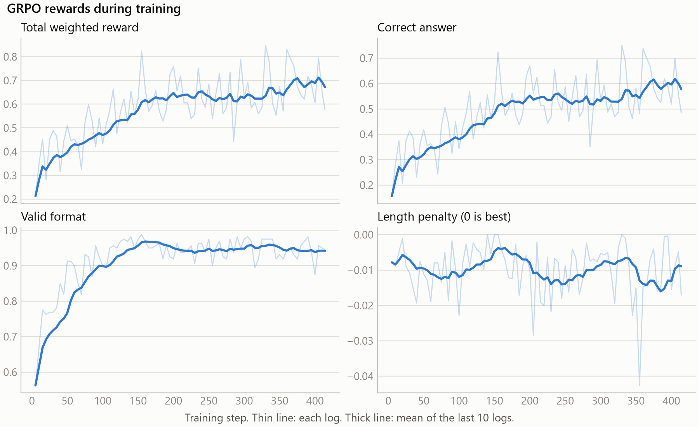
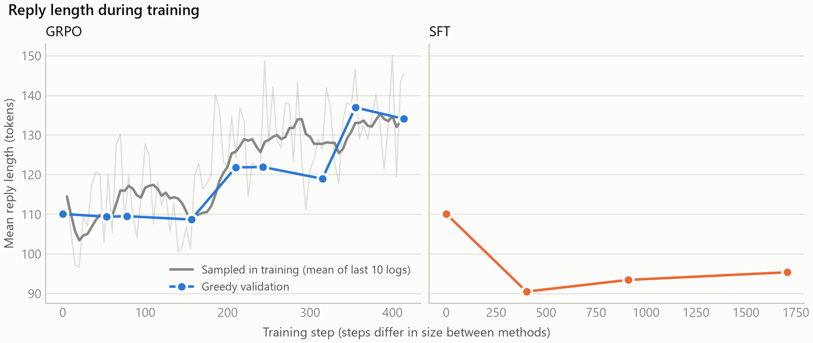

# grpo-reasoning

Can a small model get better at maths using only rewards for correct answers, with no worked solutions to copy? This project applies GRPO, the reinforcement learning method behind DeepSeek-R1, to Qwen2.5-0.5B-Instruct on GSM8K, and compares it with the untrained model and a supervised fine-tune.

**Result:** on the 1,319 test problems, GRPO reached 47.5% strict accuracy against 34.8% for the base model (paired exact McNemar p = 5.5e-19). This is one run with one seed, and the supervised comparison has caveats, covered below.


*The SFT bars repeat Base because selection kept SFT's untrained step 0. See [Results](#results) for how a trained SFT checkpoint scored.*

## Method

**Models.** All three share one prompt and the same base weights. SFT and GRPO train identical LoRA adapters (r 16, alpha 32, on `q_proj`, `k_proj`, `v_proj`, `o_proj`).

| Model | Training |
|---|---|
| Base | None |
| SFT | Copies GSM8K's human solutions, rewritten into the reply format |
| GRPO | Samples its own replies and learns from their rewards |

**Prompt.** A system instruction, one hand-written worked example, the question, and a reply pre-filled with `<think>`. The model must end up with `<think>...</think><answer>...</answer>`.

**GRPO step.** Sample 8 replies to each of 4 problems (32 replies), score them, and compare each reply with the others for its problem. Replies that beat their group become more likely. A KL penalty (`beta` 0.001) discourages drifting from the base model.

**Reward.** Only code judges a reply:

| Component | Weight | Rule |
|---|---|---|
| Correct | 1.0 | The number in `<answer>` exactly matches the known answer |
| Format | 0.1 | One think block, one answer block, a numeric answer |
| Length | 0.05 | 0 up to 700 characters, falling to -1 at 1,100 |

**Keeping it fair.**
- Validation is 200 problems from GSM8K's train split. Training uses the other 7,273.
- Both trainers validate every 30 minutes of training time, and each keeps its best validation checkpoint. Validation time does not count against the budget.
- The test set was used for final scoring, not for choosing checkpoints.
- Scoring uses greedy decoding with Qwen's sampling defaults overridden.
- Intervals are Wilson 95%. Model comparisons are exact paired McNemar tests.

**Lenient accuracy** takes the last number anywhere in the reply. It separates maths errors from format errors and is never used as a reward. It is a rough measure.

## Setup

| Item | Value |
|---|---|
| Model | `Qwen/Qwen2.5-0.5B-Instruct` |
| Data | `openai/gsm8k`, config `main` |
| Hardware | NVIDIA GeForce RTX 3060 Laptop GPU, 6 GB |
| Software | Python 3.12.10, torch 2.14.1+cu126, trl 1.17.1, transformers 5.22.1, peft 0.21.2, datasets 5.1.0, accelerate 1.15.0 |
| Seed | 42 |
| Reply limit | 256 tokens |
| Budget | 240 minutes of training per model |
| GRPO | Learning rate 2e-5, 8 replies per problem, 32 replies per step, temperature 1.0 |
| SFT | Learning rate 1e-4, batch 8, stops after 3 validations without improvement |

Every setting is in [configs/default.yaml](configs/default.yaml). Each `results/default/env_*.json` records the versions, GPU, config and git commit for that stage.

## Results

Test set, 1,319 problems. Source: [comparison.json](results/default/comparison.json) and [diagnostics.json](results/default/diagnostics.json).

| Model | Strict accuracy (95% interval) | Lenient accuracy | Valid format | Mean length (tokens) | Clipped at limit |
|---|---|---|---|---|---|
| Base | 34.8% (32.3–37.4) | 37.1% | 86.1% | 113.9 | 3.6% |
| SFT, as selected (step 0, identical to Base) | 34.8% (32.3–37.4) | 37.1% | 86.1% | 113.9 | 3.6% |
| **GRPO, as selected (step 355)** | **47.5% (44.8–50.2)** | **48.1%** | **93.7%** | **142.8** | **5.1%** |
| SFT `checkpoint-1500`, post-hoc | 35.6% (33.1–38.3) | 36.1% | 96.9% | 101.4 | 2.9% |

| Comparison | Only the first right | Only the second right | McNemar p |
|---|---|---|---|
| Base vs GRPO | 97 | 264 | 5.5e-19 |
| SFT `checkpoint-1500` vs GRPO (post-hoc) | 107 | 263 | 2.8e-16 |
| SFT `checkpoint-1500` vs Base (post-hoc) | 184 | 173 | 0.60 |

**The gain is mostly not formatting.** GRPO was right and Base wrong on 264 problems. On 209 of those, Base had a valid format and simply gave the wrong answer. Lenient accuracy also rose by 11.0 points.

**Trained SFT fixed the format but not the maths.** Compared with Base, its valid-format rate rose by 10.8 points, while strict accuracy showed no detectable change.

**Run sizes.** GRPO trained for 240.4 minutes, 414 steps and 13,248 sampled replies. SFT stopped early after 90.1 minutes, 1,708 steps and 13,664 examples.

### Training curves






## What went wrong

**The base model ignored the format.** Instructions and examples alone almost never produced it, and pre-filling alone broke the answers. Only the combination worked. These runs scored the base model on validation, and this choice was made on the same split later used to select checkpoints. Source: [prompt_selection.json](results/default/prompt_selection.json).

| Prompt | Strict | Lenient | Valid format |
|---|---|---|---|
| Instruction only | 0.5% | 47.5% | 0.0% |
| Example in the system prompt | 1.0% | 51.5% | 0.0% |
| Example as a chat turn | 0.0% | 56.5% | 0.0% |
| Pre-filled `<think>` only | 0.5% | 13.0% | 0.0% |
| **Example as a chat turn, plus pre-fill (used)** | **56.0%** | **59.5%** | **88.5%** |

**Reward hacking in an early smoke run.** With no reply ever correct, the length penalty was the only signal left. Group-level reward scaling inflated it, so replies collapsed to a few tokens. A usable prompt and `scale_rewards: batch` fixed this. Those logs were not kept, so there are no figures here.

**Validation was far more optimistic than test.** The same base model scored very differently across splits. Source: [diagnostics.json](results/default/diagnostics.json).

| Base model on | Problems | Strict accuracy (95% interval) |
|---|---|---|
| Validation | 200 | 56.0% (49.1–62.7) |
| Other GSM8K train problems | 1,000 | 47.1% (44.0–50.2) |
| Test | 1,319 | 34.8% (32.3–37.4) |

Two things seem to be happening. The 200 validation problems may simply be an easy draw, since those intervals overlap. The gap between train and test is too wide for chance. One possible cause is that the model saw GSM8K's train problems before release, but that was not tested. The saved test scoring was checked: gold answers line up with the test order, and rescoring matches.

**SFT's selection kept nothing.** All three trained validation scores (50.5%, 44.5%, 49.0%) were below step 0 (56.0%), so early stopping ended it and selection kept the untrained adapter. The planned comparison therefore says nothing about supervised training, which is why `checkpoint-1500` was scored afterwards. If validation favours what the base model already knows, this selection may have been biased against SFT. The post-hoc score doesn't support a large hidden gain, but one checkpoint can't rule it out. The final step 1,708 was not saved as a checkpoint.

**KL kept climbing.** Mean KL rose from 0.0019 in the first 5 logs to 0.1979 in the last 5, while entropy fell from 0.5535 to 0.0976. Accuracy rose and replies grew, so this was not a repeat of the smoke-run collapse. It does show that `beta` 0.001 barely restrained the model.

**Training reward overstates learning.** Sampled correctness rose from 0.2787 to 0.5694. As entropy falls, sampled replies drift towards the greedy reply, so part of that rise is the model getting more deterministic. Greedy scores are the ones to trust.

**Replies got longer.** Mean test length grew from 113.9 to 142.8 tokens, and clipped replies from 3.6% to 5.1%. Replies cut off at the limit cannot score. The length penalty didn't stop this.

**Silent failures during development.** None of these raised an error, and no figures were kept:
- A stale `datasets` cache served old prompts while runs still exited cleanly. Caching is now off across the project, with a test.
- TRL closed the pre-filled assistant turn in conversational prompts. GRPO now receives rendered strings, with a guard.
- At chunks of 8 replies, GRPO needed more memory than the 6 GB card has. Chunks of 4 fit, with the same 32 replies per step.

**Uneven speed.** Each 30-minute window managed between 25 and 78 steps, and logged step times ranged from 18.1 to 171.3 seconds. The cause was not found. GPU memory near its limit and other laptop use are both possible.

## Limitations

- **One seed.** The effect is large within this run, but its variation across seeds is unknown.
- **Compute was not equal.** GRPO used 240.4 minutes and SFT 90.1. GRPO saw about 1,656 problems, 8 replies each, while SFT saw 13,664 examples.
- **Learning rates were not tuned** for either method, so this does not show GRPO beats supervised training in general.
- **Post-hoc figures are extra.** The `checkpoint-1500` scores used the test set after the main results were seen. They were not used to select anything.
- **Validation is small.** With 200 problems and 9 checks, step 355's 66.0% is likely optimistic.
- **Early test-set contact.** Smoke runs scored the first 8 test problems, and a few replies were read. No decision used them.
- **Not comparable with published GSM8K numbers.** The prompt includes a worked example and pre-fill, and replies are limited to 256 tokens.
- **Tested on one setup only.** Python 3.12.10 on the laptop above. The project asked for Python 3.11, which was not tested, and neither was the fp16 path meant for a T4.

## Reproduce

```
python -m venv .venv
.venv\Scripts\activate          # Linux or Colab: source .venv/bin/activate
pip install -r requirements.txt
python -m pytest -q
```

Run everything with one command on Windows:

```
powershell -File scripts/run_all.ps1 -Config configs/quick.yaml -RunName quick
```

Or run each stage on any system:

```
python -m src.train_grpo --config configs/quick.yaml
python -m src.train_sft --config configs/quick.yaml
python -m src.eval --config configs/quick.yaml --name base
python -m src.eval --config configs/quick.yaml --name sft
python -m src.eval --config configs/quick.yaml --name grpo
python -m src.eval --config configs/quick.yaml --compare
python -m src.plots --config configs/quick.yaml
```

Use `configs/default.yaml` for the full run. The checks in this README come from `scripts/compare_prompts.py` and `scripts/diagnose.py`. [notebooks/colab.ipynb](notebooks/colab.ipynb) is a thin wrapper for a free GPU.

| Run | Time | Status |
|---|---|---|
| Full, `configs/default.yaml` | 6 h 41 min on the laptop above ([stage_times.txt](results/default/stage_times.txt)) | Done |
| Quick, `configs/quick.yaml` | Budgeted at under 2 hours | TODO: not run yet |
| Colab or Kaggle | Unknown | TODO: not run yet, and `REPO_URL` in the notebook is blank |

The quick run is unlikely to reproduce the full result. It has one eighth of the training budget, and GRPO's validation score had barely moved at step 53, about the first 30 minutes of the full run.
